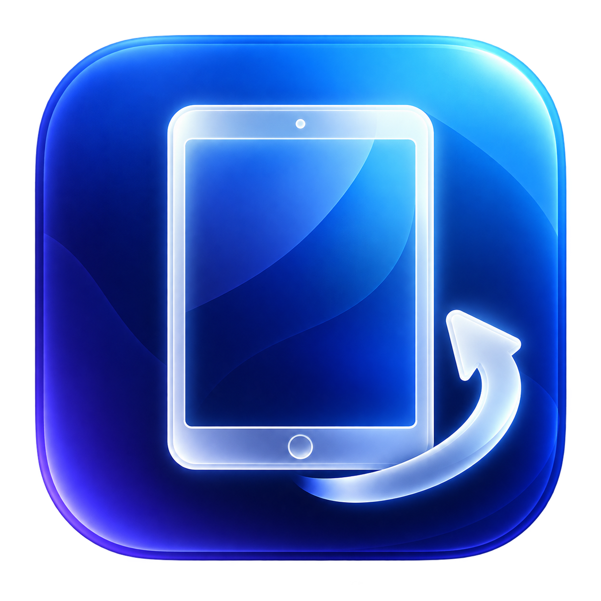

<p align="center"></p>
<h1 align="center">Portrait Sidecar</h1>
<p align="center">A free portrait workspace for your Sidecar iPad.</p>

Portrait Sidecar creates a Retina virtual desktop, rotates it on the GPU, and presents it on an iPad already connected through Apple's Sidecar. No BetterDisplay subscription, iPad companion app, account, or server is required by this utility.

## Features

- Native macOS window with adaptive light/dark colors and Liquid Glass on macOS 26+; a native translucent fallback on macOS 14–15.
- Appearance menu: follow the system, light, or dark. Glass styling follows that appearance on supported macOS versions.
- Workspace dropdown: Larger Text, Comfortable, More Space, Most Space. Sizes adapt to the connected display's aspect ratio.
- Rendering dropdown: Retina 2× by default, with an explicit Standard 1× option. Size and rendering can change during a session.
- Direct Metal/Core Image rendering, latest-frame buffering, and a capture limit of 60 fps.
- Dock-friendly display placement and redirection of the pointer from the physical Sidecar target to the portrait source.
- Flip orientation, stop/restore, and disconnect handling. Workspace and appearance preferences are remembered.

## Requirements and iPad compatibility

**Mac:** macOS 14 Sonoma or later, a Metal-capable Mac that supports Sidecar, and Screen Recording permission for Portrait Sidecar. Apple's Sidecar requirements also apply. Liquid Glass requires macOS 26 or later; the same app uses a standard native material on older versions.

**iPad:** an existing working Sidecar connection. Apple's supported families are:

| iPad family | Apple's Sidecar requirement |
| --- | --- |
| iPad Pro | All models |
| iPad | 6th generation or newer |
| iPad mini | 5th generation or newer |
| iPad Air | 3rd generation or newer |

Apple specifies iPadOS 13 or later for Sidecar. The Mac and iPad must use the same Apple Account with two-factor authentication; USB requires trusting the Mac. See [Apple's current Sidecar requirements](https://support.apple.com/en-us/102597).

This project **does not make unsupported iPads compatible with Sidecar**. It is expected to work with supported iPads because it uses the connected display's dimensions, but only an iPad Air 3 has been tested with the complete utility so far. The preset calculations are tested against six iPad resolutions; that is not a hardware compatibility test. Other iPads and Intel Macs still need field testing.

## Build and run

Install Apple's Xcode Command Line Tools (`xcode-select --install`) and use a current SDK that includes macOS 26 AppKit declarations (Xcode/Command Line Tools 26+).

```sh
bash test.sh
bash build.sh
open build/PortraitSidecar.app
```

The build targets macOS 14+, on the current machine's architecture. Build on Apple silicon for arm64 or on Intel for x86_64; it is not a universal binary. No third-party dependencies are downloaded.

1. Connect your iPad using Sidecar as an **extended display**. Hide Sidecar's Sidebar and Touch Bar.
2. Launch Portrait Sidecar and select the Sidecar display.
3. Choose **Comfortable** and **Retina 2×** to start with sharp, readable text.
4. Click **Start**. Enable Portrait Sidecar in System Settings → Privacy & Security → Screen & System Audio Recording when requested. Quit and reopen if macOS asks.
5. Stand the iPad vertically. Move windows and your pointer beyond the right edge of the main display onto **Portrait Workspace**.
6. Use **Flip** if the image is upside down. Use the dropdowns to adjust size and rendering without rebuilding the app.
7. Move important windows back before **Stop** or **Quit**. Those actions remove the virtual desktop and restore the target's original position.

The physical Sidecar desktop is only the presentation target. Work on **Portrait Workspace**. Direct iPad touch/Pencil coordinates are not remapped by this project. Normal Mac keyboard and mouse input works on the source workspace.

## Appearance and artwork

The window uses semantic system colors and native controls, respects system appearance, and uses native material behavior for accessibility settings such as Reduce Transparency. A single high-contrast glass icon remains legible on light and dark backgrounds. The project includes its PNG source and ICNS bundle; this is not an Icon Composer multilayer asset or a separate system-tinted icon set.

## Performance and troubleshooting

The capture frame is rendered straight into a Metal drawable, without creating a CGImage for each frame. The app keeps only the latest capture frame and bounds GPU work in flight. The status line reports capture size, output size, and updated frames per second. A static desktop naturally reports few updates; this is not a measured iPad refresh rate.

An earlier full-resolution motion test measured 57 updated fps **locally** at 1668 × 2224 capture → 2224 × 1668 output on the development Mac. Sidecar encoding, transport, and iPad decoding add their own latency and compression. Use USB when practical. More Space / Most Space can render above the iPad's native resolution and may be slower.

- **Blurry:** choose Retina 2×. Standard 1× intentionally uses fewer pixels. The status detail distinguishes workspace points from rendered pixels.
- **Unavailable mode:** choose another preset. Display-mode availability can differ across macOS releases; unavailable modes are reported instead of silently substituting 1×.
- **Sideways pointer / clicks do not work:** use the virtual workspace, not the underlying Sidecar desktop. The app redirects a pointer that wanders into the target; macOS may restrict cursor warping in some environments.
- **Dock missing:** the app keeps the hidden target beyond the far-right corner, leaving the main display's bottom edge clear. Verify the main display in System Settings → Displays.
- **Rebuilt app cannot capture:** local ad-hoc signatures change when rebuilding. Remove the stale Screen Recording entry, add the current app, then quit/reopen it. This does not require disabling SIP or Gatekeeper.
- **Disconnected iPad:** reconnect Sidecar, then refresh the display list and start again.

## Privacy and limitations

The app captures the virtual workspace for local presentation. It does not record audio, save screen frames, use analytics, or make network requests. Apple's Sidecar manages the Mac-to-iPad connection separately.

Virtual display creation uses the **undocumented CGVirtualDisplay API**. OS updates can change its behavior. This is an experimental utility, not an App Store or Apple-supported product. Compatibility with older supported macOS versions and different hardware is not yet fully verified. No installer, auto-launch service, or background daemon is installed.

## Development and releases

The repository includes `Source/`, `Assets/`, `Tests/`, `Info.plist`, build/test scripts, licenses, and documentation. `.gitignore` excludes local app bundles and build artifacts.

[Check Releases](https://github.com/jackson296/portrait-sidecar/releases) for packaged builds, or build from source using the commands above. Local builds are ad-hoc signed and have not been notarized. Developer ID signing and notarization are recommended for wider binary distribution.

See [TESTING.md](TESTING.md) for the exact validation completed and the remaining hardware and appearance checks. Contributions and compatibility reports are welcome; include your Mac model, macOS version, iPad model, and whether Sidecar is using USB or Wi-Fi.

## License

MIT; see [LICENSE](LICENSE). Third-party declarations retain the original DeskPad MIT license. See [NOTICE.md](NOTICE.md).
